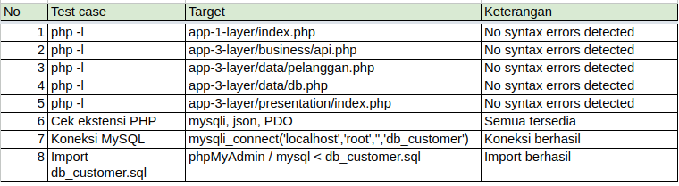
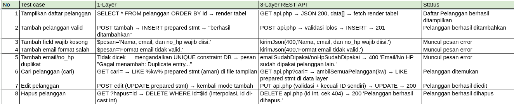
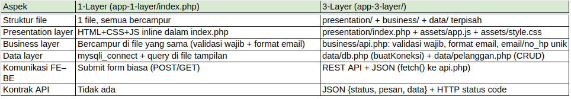
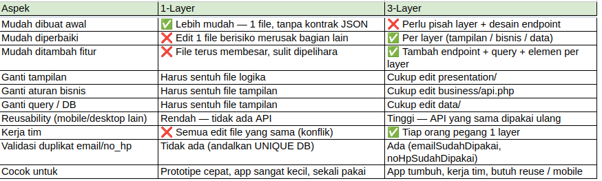

# Sistem Manajemen Pelanggan — 1-Layer vs 3-Layer Web Application Architecture

Proyek ini adalah implementasi **Sistem Manajemen Pelanggan (Customer Management System)** dengan **PHP native + `mysqli` + MySQL** yang dibuat dalam dua pendekatan arsitektur untuk perbandingan pembelajaran dan presentasi:

- **1-Layer (Non-Layered)** di `app-1-layer/index.php` — tampilan, logika bisnis, dan query database bercampur dalam satu file. Cocok untuk prototipe cepat.
- **3-Layer** di `app-3-layer/` — `presentation/`, `business/`, dan `data/` terpisah dan berkomunikasi melalui **REST API + JSON**. Cocok untuk aplikasi yang tumbuh, kerja tim, dan dipakai ulang (web + mobile).

Keduanya memiliki fitur CRUD yang sama: **tambah, tampilkan, cari, edit, dan hapus** data pelanggan (`nama`, `email`, `no_hp`, `alamat`) pada database `db_customer`, tabel `pelanggan`.

## Fitur Utama

| Fitur | 1-Layer (`app-1-layer/`) | 3-Layer (`app-3-layer/`) |
|---|---|---|
| Tampilkan daftar pelanggan | `SELECT * FROM pelanggan ORDER BY id` → render tabel langsung | `GET business/api.php` → JSON → `fetch()` render tabel |
| Tambah pelanggan | Submit form POST `tambah` → `INSERT` prepared statement | `POST business/api.php` (JSON) → validasi → `INSERT` → `201` |
| Edit pelanggan | Submit form POST `edit` → `UPDATE` prepared statement | `PUT`/`PATCH business/api.php` (JSON) → validasi → `UPDATE` → `200` |
| Hapus pelanggan | Link GET `?hapus=id` → `DELETE` + konfirmasi | `DELETE business/api.php` (JSON `{id}` atau `?id=`) → `200` |
| Cari pelanggan | GET `?cari=` → `LIKE %kata%` (prepared statement) | `GET business/api.php?cari=` → `LIKE` prepared statement di data layer |
| Validasi | Wajib diisi + format email (di file tampilan) | Wajib diisi + format email + email/no_hp unik (di `business/api.php`) |
| Notifikasi | Kotak notifikasi inline + auto-hide 4 detik | Kotak notifikasi JS + auto-hide 4 detik |

## Struktur Folder

```
tugas-3-layer-architecture/
├── README.md                        # dokumentasi ini
├── ANALISIS.md                      # perbandingan 1-Layer vs 3-Layer + jawaban pertanyaan slide
├── app-1-layer/
│   └── index.php                    # SATU FILE: HTML + CSS + JS + validasi + SQL (773 baris)
├── app-3-layer/
│   ├── presentation/
│   │   ├── index.php                # HTML murni + form + tabel (tanpa PHP/logika/SQL)
│   │   └── assets/
│   │       ├── app.js               # fetch() REST API + render tabel + notifikasi
│   │       └── style.css            # seluruh gaya tampilan
│   ├── business/
│   │   └── api.php                  # terima JSON, validasi bisnis, kirim JSON (tanpa HTML)
│   └── data/
│       ├── db.php                   # buatKoneksi() — koneksi mysqli
│       └── pelanggan.php            # query CRUD + cek unik email/no_hp
├── db/
│   └── db_customer.sql              # CREATE DATABASE + CREATE TABLE + data contoh
├── diagram/
│   ├── DIAGRAM-ARSITEKTUR.md        # diagram Mermaid + diagram teks + tabel pengujian
│   ├── DIAGRAM-ARSITEKTUR.drawio    # sumber diagram arsitektur (draw.io)
│   ├── DIAGRAM-TEKS.drawio          # sumber diagram teks (draw.io)
│   ├── DIAGRAM-ARSITEKTUR-1-Layer.drawio(2).png
│   └── DIAGRAM-TEKS.drawio(1).png
├── tabel/
│   └── DIAGRAM-ARSITEKTUR_Tabel-3-4.xlsx  # tabel lampiran (Excel)
│   ├── tabel-pengujian-1.png          # Tabel 3a — Uji sintaks (php -l)
│   ├── tabel-pengujian-2.png          # Tabel 3b — Uji fungsional CRUD
│   ├── tabel-perbandingan-1.png        # Tabel 4a — Perbandingan arsitektur
│   └── tabel-perbandingan-2.png        # Tabel 4b — Perbandingan operasional
└── notes/
    ├── MISSION.md                   # tujuan & kriteria keberhasilan tugas
    ├── NOTES.md
    ├── GLOSSARY.md
    └── RESOURCES.md
```

> Akar folder di atas adalah folder proyek ini. Sesuaikan path akses web (`http://localhost/...`) dengan nama folder di `htdocs` kamu.

## Diagram Desain

### 1-Layer (Non-Layered)


- Semua tanggung jawab ada dalam satu file; edit tampilan berarti edit file yang sama dengan logika dan SQL.
- Komunikasi frontend–backend memakai `$_GET` / `$_POST` langsung, tanpa JSON/API.
> Gambar: arsitektur **1-Layer**. Browser ⇄ satu file `app-1-layer/index.php` (tampilan + bisnis + data) ⇄ MySQL `db_customer.pelanggan`. Sumber: `diagram/DIAGRAM-ARSITEKTUR.drawio`.

### 3-Layer


> Gambar: arsitektur **3-Layer**. User → Presentation (`presentation/index.php`, `assets/app.js`, `style.css`) → REST API + JSON → Business (`business/api.php`) → Data (`data/db.php`, `data/pelanggan.php`) → MySQL. Sumber: `diagram/DIAGRAM-TEKS.drawio`.

### Perbedaan 1-Layer vs 3-Layer

| Aspek | 1-Layer | 3-Layer |
|---|---|---|
| Struktur file | 1 file `app-1-layer/index.php` | `presentation/` + `business/api.php` + `data/` |
| Komunikasi | Submit form biasa | REST API + JSON (`fetch()`) |
| Validasi duplikat | Tidak ada pengecekan eksplisit — mengandalkan constraint `UNIQUE` database | Ada: `emailSudahDipakai()` / `noHpSudahDipakai()` |
| Kontrak API | Tidak ada | JSON `{status, pesan, data}` + HTTP status code |
| Reusability | Rendah (logika menyatu dengan HTML) | Tinggi (API bisa dipakai ulang) |

Detail perbandingan dan jawaban 5 pertanyaan slide ada di `ANALISIS.md`.

## Jawaban Pertanyaan Slide

*Disalin langsung dari `ANALISIS.md` (bagian "Jawaban pertanyaan di slide"). Catatan: folder non-layered disebut `app-non-layered/` di `ANALISIS.md`; di proyek ini foldernya adalah `app-1-layer/`.*

### Mana yang lebih mudah dibuat?
**Non-layered.** Semua ada dalam satu file, tanpa perlu memikirkan kontrak API JSON atau memisahkan fungsi. Cocok untuk tugas cepat dan aplikasi sangat kecil.

### Mana yang lebih mudah diperbaiki ketika terjadi kesalahan?
**3-Layer.** Kalau error tampilan rusak, yang diubah hanya presentation. Kalau aturan bisnis salah, yang diubah hanya business. Di non-layered, satu edit di file tunggal berisiko merusak bagian lain yang bercampur—misalnya mengubah HTML bisa tanpa sengaja menghapus logika form.

### Mana yang lebih mudah dikembangkan ketika fitur bertambah?
**3-Layer.** Fitur baru berarti menambah fungsi di layer yang sesuai (misalnya endpoint baru di business + query baru di data + elemen di presentation), tanpa menyentuh layer lain. Di non-layered, file terus membesar dan sulit dipahami.

### Apa risiko jika seluruh kode ditempatkan dalam satu file?
- File makin panjang dan sulit dibaca/diperbaiki.
- Perubahan di satu bagian mudah merusak bagian lain.
- Tidak bisa dipakai ulang (API tidak terpisah).
- Duplikasi kode (misalnya validasi yang sama ditulis ulang di setiap form).
- Kerja tim sulit: semua orang mengedit file yang sama.

### Apakah aplikasi tanpa 3-layer selalu lebih buruk?
**Tidak selalu.** Untuk proyek kecil / sekali pakai / prototipe, non-layered lebih cepat dan cukup. Arsitektur 3-layer baru layak ketika aplikasi tumbuh, dikerjakan tim, atau butuh dipakai ulang (mobile + web). Keduanya punya trade-off kecepatan vs keteraturan.

## Penjelasan Program

### 1-Layer — `app-1-layer/index.php` (tanpa fungsi, berupa blok `if` inline)

| Blok | Pemicu | Fungsi |
|---|---|---|
| Koneksi + guard | Setiap request | `mysqli_connect()`; `mysqli_report(MYSQLI_REPORT_OFF)`; stop dengan `die('Koneksi gagal: ' . mysqli_connect_error())` bila gagal |
| Tambah | `$_POST['tambah']` | Baca `nama/email/no_hp/alamat`, validasi wajib + format email, `INSERT` prepared statement |
| Edit | `$_POST['edit']` | Validasi sama, `UPDATE` prepared statement, set `$editBerhasil = true` |
| Hapus | `$_GET['hapus']` (tanpa POST tambah/edit) | `DELETE FROM pelanggan WHERE id=$id` (id di-cast `(int)`) |
| Muat data edit | `$_GET['edit']` (tanpa POST tambah, tanpa edit sukses) | `SELECT * FROM pelanggan WHERE id=$id` → `$dataEdit` |
| Tampil + cari | Setiap request | `SELECT * ORDER BY id` atau `WHERE nama/email/no_hp/alamat LIKE ?` prepared statement |

### 3-Layer — `app-3-layer/data/db.php` dan `app-3-layer/data/pelanggan.php`

| Fungsi | File | Fungsi |
|---|---|---|
| `buatKoneksi()` | `data/db.php` | Membuat koneksi `mysqli_connect('localhost','root','','db_customer')`; `null` bila gagal |
| `tambahPelanggan($koneksi, $nama, $email, $noHp, $alamat)` | `data/pelanggan.php` | `INSERT` prepared statement; return bool |
| `ambilSemuaPelanggan($koneksi, $kataKunci = '')` | `data/pelanggan.php` | Ambil semua atau `LIKE %kata%` (prepared statement); return array |
| `ambilSatuPelanggan($koneksi, $id)` | `data/pelanggan.php` | `SELECT * WHERE id=$id`; return assoc array / `null` |
| `editPelanggan($koneksi, $id, $nama, $email, $noHp, $alamat)` | `data/pelanggan.php` | `UPDATE` prepared statement; return bool |
| `hapusPelanggan($koneksi, $id)` | `data/pelanggan.php` | `DELETE WHERE id=$id`; return bool |
| `emailSudahDipakai($koneksi, $email, $kecualiId = null)` | `data/pelanggan.php` | Cek `email` unik (dengan pengecualian id sendiri saat edit) |
| `noHpSudahDipakai($koneksi, $noHp, $kecualiId = null)` | `data/pelanggan.php` | Cek `no_hp` unik (dengan pengecualian id sendiri saat edit) |

### 3-Layer — `app-3-layer/business/api.php`

| Fungsi | Fungsi |
|---|---|
| `kirimJson($status, $data = null, $pesan = '')` | Set `http_response_code()`, `echo json_encode(['status','pesan','data'])`, `exit` |
| `bacaBodyJson()` | Baca `php://input`, `json_decode`; `[]` bila kosong/tidak valid |
| `validasiData($koneksi, $input, $kecualiId = null)` | Trim + cek wajib / format email / unik email & no_hp; return `[ok, pesan, dataBersih]` |

| Method HTTP | Input | Respons HTTP | Fungsi |
|---|---|---|---|
| `GET` (tanpa `id`) | `?cari=` opsional | `200` | Daftar pelanggan |
| `GET` + `?id=` | `id` | `200` / `404` | Satu pelanggan |
| `POST` | JSON `{nama,email,no_hp,alamat}` | `201` / `400` / `500` | Tambah |
| `PUT` / `PATCH` | JSON `{id,nama,email,no_hp,alamat}` | `200` / `400` / `404` / `500` | Edit (validasi kecuali id sendiri) |
| `DELETE` | JSON `{id}` atau `?id=` | `200` / `400` / `404` / `500` | Hapus |
| Method lain | — | `405` | `Method tidak didukung.` |

Contoh kontrak respons:

```json
{ "status": 201, "pesan": "Pelanggan berhasil ditambahkan.", "data": null }
```

### 3-Layer — `app-3-layer/presentation/assets/app.js`

| Fungsi | Fungsi |
|---|---|
| `muatDaftarPelanggan()` | `fetch` `GET ../business/api.php` (+ `?cari=`), render tabel via `escapeHtml()` |
| `editPelanggan(id)` | `fetch GET ?id=`, isi form ke mode Edit |
| `hapusPelanggan(id)` | `confirm()`, `fetch DELETE`, reload daftar |
| `tampilkanStatus(pesan, modeError)` / `sembunyikanStatus()` | Notifikasi sukses/gagal, auto-hide 4 detik |
| `bersihkanForm()` | Reset form ke mode Tambah |
| `terapkanPencarian()` | Terapkan kata kunci; dipanggil saat submit dan saat mengetik (debounce 300 ms) |
| `escapeHtml(teks)` | Escape HTML sebelum render (anti-XSS) |

## Alur Program

### 1-Layer

1. Browser membuka `app-1-layer/` → PHP melakukan `mysqli_connect()`; bila gagal, halaman berhenti dengan pesan `Koneksi gagal: ...`.
2. Bila ada `$_GET['edit']` (dan bukan setelah Tambah/Edit sukses), satu baris dimuat ke form → form berjudul `Edit Pelanggan` + hidden `id`.
3. Bila ada `$_POST['tambah']` / `$_POST['edit']`: validasi (wajib, format email) → query prepared statement → `$pesan` sukses/gagal.
4. Bila ada `$_GET['hapus']` (tanpa POST tambah/edit): `DELETE` + konfirmasi `Hapus pelanggan ini?`.
5. Daftar dimuat: semua baris atau hasil `LIKE %cari%` → dirender sebagai tabel HTML + notifikasi.

### 3-Layer — Tambah Pelanggan (contoh)

1. User mengisi form di `presentation/index.php` → `app.js` `preventDefault()`, kumpulkan JSON `{nama,email,no_hp,alamat}`.
2. `fetch POST ../business/api.php` → `api.php` `bacaBodyJson()` → `validasiData()`.
3. Validasi lolos → `tambahPelanggan()` → `INSERT` prepared statement → MySQL menyimpan baris.
4. `api.php` `kirimJson(201, ...)` → `app.js` `bersihkanForm()` → `tampilkanStatus()` → `muatDaftarPelanggan()` (reload tabel).

### 3-Layer — Edit, Hapus, dan Cari

- **Edit**: klik `Edit` → `GET ?id=` → form terisi, judul jadi `Edit Pelanggan`, tombol jadi `Simpan Perubahan` → submit → `PUT` (+ `id`) → validasi kecuali id sendiri → `UPDATE` → `200` → reset form + reload tabel.
- **Hapus**: klik `Hapus` → `confirm('Hapus pelanggan ini?')` → `DELETE {id}` → cek `404` bila id tidak ada → `200` → reload tabel.
- **Cari**: ketik di kolom pencarian → debounce 300 ms → `GET ?cari=` → `LIKE` prepared statement → render hasil; tombol `Reset` mengosongkan kata kunci.

## Error Handling

| Bagian | Kondisi tidak valid | Penanganan (pesan verbatim dari code) |
|---|---|---|
| 1-Layer: koneksi | `mysqli_connect` gagal | `die('Koneksi gagal: ' . mysqli_connect_error())` |
| 1-Layer & 3-Layer: wajib | `nama`/`email`/`no_hp` kosong | `Nama, email, dan no_hp wajib diisi.` |
| 1-Layer & 3-Layer: email | `filter_var(..., FILTER_VALIDATE_EMAIL)` gagal | `Format email tidak valid.` |
| 3-Layer: duplikat email | `email` sudah dipakai orang lain | `Email sudah dipakai pelanggan lain.` (HTTP 400) |
| 3-Layer: duplikat no_hp | `no_hp` sudah dipakai orang lain | `No HP sudah dipakai pelanggan lain.` (HTTP 400) |
| 1-Layer: duplikat | Menabrak `UNIQUE` database | `Gagal menambah: Duplicate entry...` (pesan error MySQL) |
| 1-Layer: tambah/edit/hapus gagal | Query DB gagal | `Gagal menambah: ...` / `Gagal mengedit: ...` / `Gagal menghapus: ...` |
| 3-Layer: koneksi | `buatKoneksi()` null | `500` — `Koneksi database gagal.` |
| 3-Layer: id tidak ada | `GET ?id=` / `PUT` / `DELETE` id tidak ditemukan | `404` — `Pelanggan tidak ditemukan.` |
| 3-Layer: id wajib | `PUT`/`DELETE` tanpa `id` | `400` — `ID pelanggan wajib ada.` |
| 3-Layer: method | Method HTTP tidak dikenal | `405` — `Method tidak didukung.` |
| 3-Layer: simpan gagal | `INSERT`/`UPDATE`/`DELETE` gagal | `500` — `Gagal menambah pelanggan: ...` / `Gagal mengedit pelanggan: ...` / `Gagal menghapus pelanggan: ...` |
| 3-Layer: tampilan | `json.data` bukan array (respons error) | Baris tabel menampilkan `json.pesan` (mis. `Gagal memuat data.`), bukan stuck di `Memuat data...` |
| Frontend: hapus | User membatalkan konfirmasi | `confirm('Hapus pelanggan ini?')` → request dibatalkan |

Pengaman lain yang ada di code: `mysqli_report(MYSQLI_REPORT_OFF)` agar PHP 8+ tidak melempar exception dan mengembalikan HTML 500 (bukan JSON), pencarian memakai `ESCAPE '\\'` agar `%`/`_`/`\` pada kata kunci diperlakukan harfiah, dan output memakai `htmlspecialchars()` (1-Layer) / `escapeHtml()` (3-Layer) agar aman dari XSS.

## Database

File: `db/db_customer.sql`

```sql
CREATE DATABASE IF NOT EXISTS db_customer;
USE db_customer;
CREATE TABLE pelanggan (
    id      INT AUTO_INCREMENT PRIMARY KEY,
    nama    VARCHAR(100)  NOT NULL,
    email   VARCHAR(100)  NOT NULL UNIQUE,
    no_hp   VARCHAR(20)   NOT NULL UNIQUE,
    alamat  VARCHAR(255)  DEFAULT NULL
);
-- Seed: Nadya, Sheva, Jillena
```

Kredensial default di code (`app-1-layer/index.php` dan `app-3-layer/data/db.php`): host `localhost`, user `root`, password kosong, database `db_customer`. Sesuaikan bila berbeda di mesin kamu.


## Tabel Pengujian dan Perbandingan


### Tabel 3a — Uji sintaks (`php -l`)



Sumber: `tabel/tabel-pengujian-1.png` ← Excel `Table1_3a`.

### Tabel 3b — Uji fungsional CRUD



Sumber: `tabel/tabel-pengujian-2.png` ← Excel `Table2_3b`.

### Tabel 4a — Perbandingan arsitektur



Sumber: `tabel/tabel-perbandingan-1.png` ← Excel `Table3_4a`.

### Tabel 4b — Perbandingan operasional



Sumber: `tabel/tabel-perbandingan-2.png` ← Excel `Table4_4b`.

